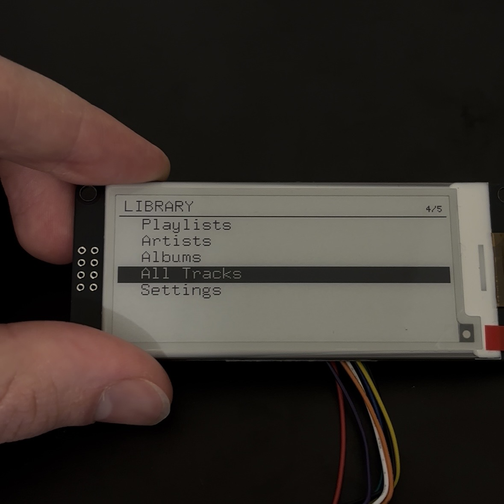
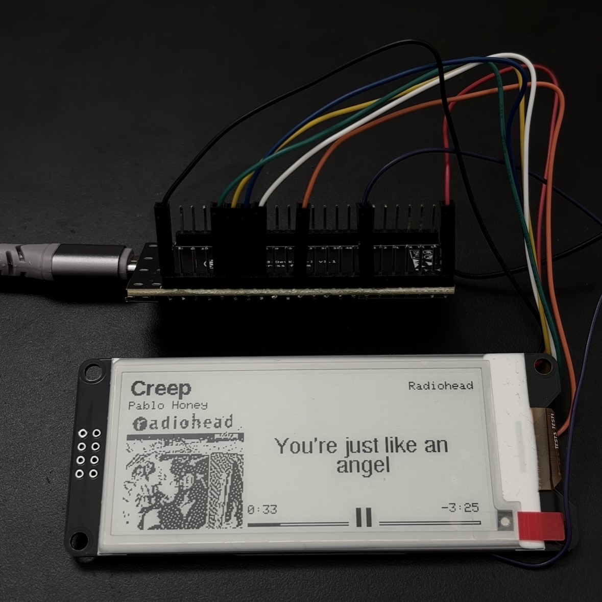

# MusicStation

*A RomansLab project: building a focused, physical way to experience music.*

MusicStation is an ESP32-S3 music player built around a 2.9-inch e-paper
display. It started as an iPhone now-playing companion and is now a
self-contained, offline station: music, artwork and synchronized lyrics on a
microSD card, five physical buttons, and MP3 playback through a MAX98357A I2S
amplifier into small speakers. No phone, no hotspot, no cloud service.

## Versions

| Version | Folder | What it is | Status |
|---|---|---|---|
| **V3** | [`V3/`](V3/README.md) | Offline station with sound: microSD library, buttons, lyrics, I2S audio | **Current.** Playing music on the wired hardware |
| V2 | [`V2/`](V2/README.md) | Offline station UI and playback model against a simulated playhead | Superseded by V3 |
| V1 | repository root | iPhone companion: BLE now-playing, artwork and lyrics over Wi-Fi | Working prototype, kept as is |

Each version is a separate sketch rather than an edit of the last, because
they have almost opposite dependency profiles: V1 needs BLE, Wi-Fi, TLS, JSON
and JPEG decoding; V3 needs none of them and spends the freed RAM on audio.

## V3: offline station with sound



V3 plays MP3s straight off the card. The decoder runs on its own core so the
roughly 780 ms e-paper refresh never interrupts the music, lyrics follow the
samples actually sent to the amplifier, and a software filter voices the
output for small cavity speakers.

- Browse by artist, album, track or playlist with five buttons; letter jump
  for long lists.
- Synchronized `.lrc` lyrics and pre-baked 1-bit cover art from the card,
  prepared on a Mac by [`V3/tools/prepare_album.py`](V3/tools/prepare_album.py).
- Hold UP/DOWN for volume; hold MENU to tune lyric sync by ear while a song
  plays.
- Resumes the same track at the same position after power-off; deep sleep
  with button wake.
- One amplifier and speaker, or two in parallel, on five GPIOs.

Start with the [V3 README](V3/README.md), then [wiring](V3/WIRING.md). Board
settings are the same for every version: ESP32-S3, USB CDC on boot, Huge APP
partition scheme, PSRAM disabled.

> **V3 status:** running on the wired hardware with a MAX98357A and an 8 ohm
> cavity speaker. Lyric timing and speaker voicing are being tuned by ear;
> battery power and an enclosure come next.

## V1: iPhone companion



V1 is the original prototype and the rest of this README documents it. It reads
now-playing metadata from an iPhone over Bluetooth, fetches album artwork and
synchronized lyrics over Wi-Fi, and renders a compact monochrome player screen.
It proved the display, refresh discipline, text rendering, artwork and lyric
handling that V2 and V3 build on.

## What V1 does today

- Pairs from normal iOS Bluetooth settings as a BLE HID accessory.
- Reads artist, album, title, duration, elapsed time, and playback state through
  Apple Media Service (AMS).
- Displays album artwork as a sharpened, dithered 96x96 monochrome image.
- Fetches synchronized lyrics from LRCLIB and follows the current lyric.
- Supports UTF-8 metadata and lyrics written with the Cyrillic alphabet.
- Shows elapsed/remaining time, progress, and a play/pause action icon.
- Updates only the affected e-paper region and suppresses repeated refreshes
  while paused or disconnected.
- Keeps BLE callbacks allocation-free and protects track assets against stale
  asynchronous metadata.

The HID report already describes play/pause, next, and previous actions, but no
buttons are wired in V1.

## Project direction

| Stage | Purpose | Status |
|---|---|---|
| V1 | ESP32-S3 + e-paper iPhone now-playing display | Done |
| V2 | microSD library, buttons, browsing UI, local lyrics and artwork | Done, in V3 |
| V3 | MP3 playback over I2S through MAX98357A, speakers | Working |
| V3 | Fully offline artwork, metadata and synchronized lyrics | Done |
| Next | Battery, power measurements, enclosure | Planned |

The destination is an appliance that plays music without a phone, hotspot, or
cloud service. V3 reaches it for playback; V1's online integrations survive
only in the Mac-side preparation tool, which fetches lyrics and artwork once
when an album is copied to the card.

## V1 hardware

- ESP32-S3 board/module using ESP32-S3-WROOM-1U
- External 2.4 GHz antenna for the `-1U` module
- WeAct Studio 2.9-inch black/white e-paper module
- DEPG0290BS 296x128 panel with SSD1680 controller

### E-paper wiring

| WeAct pin | ESP32-S3 pin | Function |
|---|---:|---|
| VCC | 3V3 | Power |
| GND | GND | Ground |
| SDA | GPIO11 | SPI MOSI, not I2C SDA |
| SCL | GPIO12 | SPI clock, not I2C SCL |
| CS | GPIO10 | Chip select |
| D/C | GPIO9 | Data/command |
| RES | GPIO8 | Reset |
| BUSY | GPIO7 | Display busy output |

MISO is not used. Power the display from 3.3 V. See [WIRING.md](WIRING.md)
for more detailed hardware notes.

## V1 software dependencies

The latest verified build uses:

- Arduino ESP32 core 3.2.1
- GxEPD2 1.6.9
- Adafruit GFX 1.12.6
- ArduinoJson 7.4.2
- JPEGDEC 1.8.4
- U8g2_for_Adafruit_GFX 1.8.0

Select an ESP32-S3 board profile with:

- USB CDC enabled on boot if you want serial diagnostics
- Huge APP partition scheme
- PSRAM disabled for the currently tested board

## Build and configure V1

1. Install the dependencies listed above through the Arduino Library Manager.
2. Copy `config.example.h` to `config.h`.
3. Put the credentials for a reachable 2.4 GHz Wi-Fi network in `config.h`.
   The file is ignored by Git and must stay local.
4. Open `MusicStation.ino` in Arduino IDE.
5. Select the ESP32-S3 board and build settings described above.
6. Compile and upload.

For the current iPhone-hotspot setup, enabling **Maximize Compatibility** can
help expose the hotspot on 2.4 GHz.

## Pairing and use

1. Power MusicStation and wait for its pairing screen.
2. Open **Settings > Bluetooth** on the iPhone or iPad.
3. Select `MusicStation` and enter the passkey shown on the e-paper display.
4. Enable the configured Wi-Fi network or Personal Hotspot.
5. Start music playback on the iPhone.

If bonding becomes corrupted, forget MusicStation on the iPhone, erase the
ESP32 bond/flash state, and pair again.

## How V1 works

```text
iPhone playback
      |
      | BLE HID + Apple Media Service
      v
   ESP32-S3  <---- Wi-Fi/HTTPS ---- iTunes artwork + LRCLIB lyrics
      |
      | SPI
      v
296x128 SSD1680 e-paper
```

The firmware streams JSON responses instead of retaining entire documents,
stores lyric text in a pooled arena, rejects stale track requests, and uses a
rolling three-row image-sharpening buffer. These choices preserve contiguous
internal heap for TLS and JPEG decoding while BLE and Wi-Fi are active.

E-paper refreshes are region-based:

- Full screen for startup and periodic cleanup
- Whole logical screen for new metadata/artwork
- Right column for lyric changes
- Bottom-right strip for time, progress, and play/pause state

## V1 limitations

- Playback audio still comes from the paired iPhone.
- Artwork and lyrics currently require internet access.
- Physical media buttons are not wired yet.
- Lyrics depend on LRCLIB having synchronized data for the recording.
- The current HTTPS prototype uses `setInsecure()` and does not validate server
  certificates.
- Cyrillic and printable ASCII are supported; other writing systems may need
  additional embedded fonts and text-layout work.
- Frequent progress updates remain the main source of e-paper refresh cycles.

## Repository safety

`config.h` is intentionally ignored. Only `config.example.h` belongs in the
repository. Before publishing a fork, scan the complete staged content and Git
history for credentials, private media, generated files, and device-specific
data.

## License

MusicStation is open-source software released under the [MIT License](LICENSE).
You may use, modify, and redistribute it, including in commercial projects,
provided the copyright and license notice are retained.
